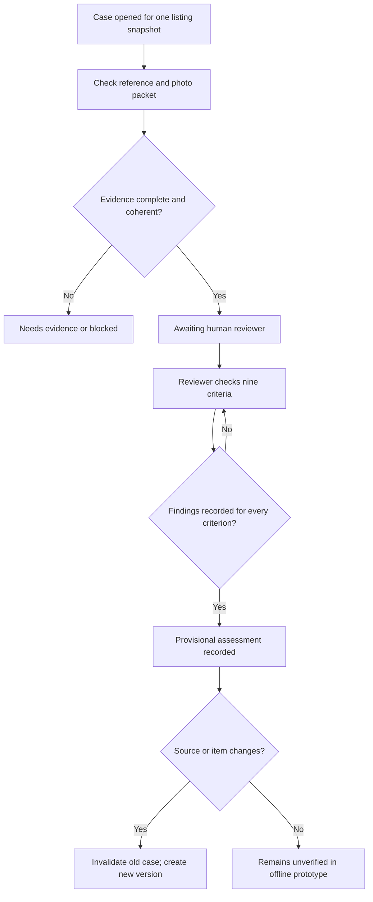

# GrailRaven — Evidence reviewer record and workflow v1

**Status (17 November 2026):** Designed and an **offline, untrusted state-machine prototype** implemented. This is **not** an authenticated reviewer service, real audit ledger, working image upload, evidence storage, production verification, B2B feature, MATCH promotion, or public UI. No live deployment or third-party licence use is authorised here.

## Why we need a review ledger

The existing shared PALScout matcher deliberately keeps seller-claim-only cases in **REVIEW**. The photo-slot checker (`shared/physical-copy-review-core.js`) can say a set of *claimed* photographs is assembled, but not that they show the actual offered game. The four release studies (`shared/physical-release-reference-study.js`) are public-reference **research candidates**, not inspected physical specimen records.

Before GrailRaven could responsibly call a seller's specific item a verified match, we need a **separate, private, authenticated human-review record**, tied to a particular seller listing and a particular collector's requested copy. A positive research-reference comparison or a complete-looking photo packet must not bypass human inspection, rights checks or listing freshness.

## 1. Immutable review-case binding (planned server authoritative)

Each future review case MUST have a stable, server-controlled binding:

| Field | Purpose |
| --- | --- |
| Case ID and schema version | Unique review instance; later revisions create a new version/record, never edit history |
| Provider + provider listing ID (private) | Connects the record to the one seller offer, not to the game globally |
| Listing snapshot hash, creation timestamp and permitted source | Proves *which snapshot was assessed* **once a trusted server calculates and stores it**; a client-submitted hash alone proves nothing |
| Reference ID **and reference version** | Cites specific independently curated physical-release rules; the current four public-research fixtures are NOT approved specimen rules |
| Collector target hash | Fixes edition, territory, completeness, price/delivery constraints and condition expectations for this assessment |
| Evidence manifest hash | Binds actual server-ingested, rights-cleared evidence files/photo view roles to the reviewed snapshot |
| Rights/consent provenance (private) | Track permission for photos, source data access, retention and reviewer display; not a general publishing/sublicensing licence |
| Created, reviewed, superseded and expiry times | Enables re-review when a seller updates stock/details or evidence/reference rules change |

**Privacy:** never commit raw listings, seller/user contacts, image content, private URLs, purchase history, API credentials or full signed agreements to GitHub. Reviewer IDs, reasons and source-permission proof belong in private access-controlled records, not externally shared outputs.

## 2. Reviewer workflow



Nine reviewer criteria (currently imported directly from `PHYSICAL_COPY_REVIEW_CHECKS`): identity/platform; edition/print; market/language; disc identifiers; expected contents; condition/damage; image originality/consistency; listing snapshot/availability; upstream rights/privacy.

For each check a human reviewer would record **CONSISTENT**, **UNCERTAIN**, or **CONTRADICTION**, with private evidence references and an explanation. A consistent report is *not an authenticity guarantee*, and a shared-PAL country ambiguity must remain unresolved even if a reviewer marks every other check consistent. The system needs a controlled path for requesting additional photos, independent confirmation and handling disagreements.

A separate, **future trusted backend** must authenticate reviewers, enforce case-level role restrictions, prevent sellers or automated classifiers from impersonating reviewers, and record exactly which verified-source materials the reviewer inspected. This is not implemented.

## 3. Offline transition engine built here

`shared/physical-review-workflow-core.js` exports `simulatePhysicalReviewWorkflow(binding, events, {now})`.

**All data passed to this function is untrusted.** It validates workflow shape and sequence, not source authenticity. It never calls a database, authenticates a reviewer, decodes photos, signs an event, or changes the production matcher.

Supported conceptual stages:

| Simulation status | Meaning |
| --- | --- |
| `INTAKE_PENDING` | No photo/reference assessment yet |
| `NEEDS_EVIDENCE` | Required packet or reference details missing |
| `BLOCKED_EVIDENCE` | Inconsistent / invalid source evidence |
| `AWAITING_REVIEW` | A supplied checklist reports a reviewable evidence packet |
| `IN_REVIEW` | Checklist recording has begun; actor identity **not authenticated** |
| `ASSESSMENT_CONSISTENT_UNTRUSTED` | Every simulated check marked consistent; **NOT a verified copy** |
| `ASSESSMENT_UNRESOLVED_UNTRUSTED` | An uncertain finding or shared-PAL ambiguity remains |
| `ASSESSMENT_CONFLICT_UNTRUSTED` | At least one contradictory finding |
| `INVALIDATED` | Listing/source/reference/evidence change, loss of source rights, item unavailable or review revoked |
| `INVALID_EVENT_LOG` | Bad binding, altered sequence, malformed event, illegal transition or an attempted privilege/approval injection |

Each simulated event has a strict schema: sequence number, event ID, previous event ID, exact listing/reference/target/evidence scope, timestamp, type and a minimal typed payload. Events cannot be skipped, replayed, reordered, re-scoped or amended with fabricated `verified`/`reviewerRole`/`MATCH` fields without being rejected by the shape/transition checker. **This is data consistency validation, not tamper-proof security.** A malicious caller can create a new, internally consistent simulated stream; a real audit ledger would require authenticated, server-generated immutable events and independent access/log controls.

Event vocabulary: `EVIDENCE_ASSESSED`, `REVIEW_STARTED`, `CHECK_RECORDED` (once per required check), `ASSESSMENT_SUBMITTED`, and `CASE_INVALIDATED`.

The code intentionally returns **only aggregate status and fixed reason codes**, never raw seller data, photo hashes, private listing identifiers or arbitrary reviewer comments.

### Non-negotiable invariant

EVERY outcome, even a consistent assessment, returns:

```json
{
  "workflowAuthority": "OFFLINE_UNTRUSTED_SIMULATION",
  "verificationState": "UNVERIFIED",
  "canPromoteToMatch": false,
  "canTriggerVerifiedAlert": false,
  "reviewRecordIsAuthoritative": false
}
```

No trusted reviewer role or approval field exists in the prototype, and it is not called by the browser Search, listing checker, Saved Hunts, marketplace adapters or production monitor. The current matcher gates still apply. The future MATCH policy is intentionally **not written**.

## 4. What would be required before actual verification

A privileged reviewer service needs all of the following, in this order:

1. **Legal/source access:** field-level source rights for inventory and particular photos; permission for private inspection/retention/display; licensing for any public attribution; UK GDPR/data minimisation and retention review for user-uploaded materials. Do not assume an eBay, IGDB, PriceCharting or retailer permission is transferable or sublicensable.
2. **Independent reference curation:** approved, versioned, rights-cleared first-party specimen/packaging evidence, with review and revisions. The existing four reference studies are **unverified research candidates**, not approved commercial evidence.
3. **Trusted ingest:** server-side file type/size validation, content checks, safe private object storage, server-computed SHA-256 and an immutable evidence manifest. Do not trust photo MIME, hashes, EXIF, listing title or `actual photos` seller flags.
4. **Reviewer authentication/authorization:** restrictive internal roles, individual accounts, least privilege, rate limits, logging, re-authentication where appropriate, and separation from seller/provider-supplied fields. Explicit protection from CSRF, session theft, cross-tenant access and overbroad signed-media URLs.
5. **Transactional append-only case ledger:** sequential version/optimistic lock, reliable event IDs and previous-event linkage, server-generated timestamps, private reviewer identity, content/snapshot/reference hashes and audit retention. Consider signed or anchored digests; a simple previous-event-ID chain is NOT tamper-evident. A reviewer must not approve their own seller listing. Make reversals and reasoned amendments append new records rather than overwriting history.
6. **Expiry and invalidation:** check provider-specific listing freshness and stock; invalidate on item/description/photo/price/condition/rights/reference changes or permission withdrawal; new evidence creates a new case version. Do not reuse an old approval for a new listing, a changed target or a different copy of the same game. Freshness/expiry policy must be stricter than a generic weekly reference update and proven per provider.
7. **Target-specific gated decision service:** only after audit and rights/security review, introduce a separate trusted policy that evaluates evidence provenance, reviewer authority, validity dates, source-rights status, specific collector target and marketplace availability. Default to REVIEW; if any essential property is unknown/conflicting, never promote to MATCH.
8. **Pilot and observability:** run an explicitly permissioned private sample; measure review minutes, proportion of candidates requiring more evidence, false positive/negative rate, reversal rate, consent/license failures and marginal cost. Only if worthwhile and authorised consider a narrow public feature.

### Failure handling rules

- A packet with missing photos or unknown disc count cannot enter final assessment.
- A listing snapshot/reference/evidence revision invalidates the previous case; a new review must be recorded for the new scope.
- A permission withdrawal blocks continued access/display; check lawful retention and deletion obligations.
- Contradictions are never silently overridden by "High confidence" OCR, seller claims or all-consistent review flags.
- A user or seller must not be allowed to submit a final reviewer decision; client-supplied role labels are not privileges.
- If a reviewer disagrees with a previous decision, append a dissent/revision rather than overwriting it. Publication/alert decisions should expire and be revocable.

## 5. Files, tests and safety

- `shared/physical-review-workflow-core.js`: pure, platform-agnostic event transition simulation; **no network, storage, passwords, sessions, images, uploads, provider data or trust-bearing MATCH APIs**.
- `tests/physical-review-workflow-core.test.mjs`: synthetic fixtures for complete/partial human checklists, shared-PAL ambiguity, missing/contradictory evidence, spoofed approval fields, altered/replayed/out-of-order events, stale/changed item scope, rights withdrawal and limited output disclosure.
- `PHYSICAL_REVIEW_WORKFLOW_V1.md`: this architecture and security/rights checklist.

**No production changes:** no IGDB signatory or source-licence updates, subscriptions, data imports, D1 mutations, Cloudflare deployments, outreach or external API access. Before any real reviewer console, genuine uploads or target-specific MATCH functionality, explicit owner approval, source rights, privacy/security work and a scoped test plan are mandatory.

## Next engineering recommendation

Design the **server-only, authentication-backed review ledger interface and strict access policy** on paper first, not a public endpoint; then prepare an isolated SQLite/D1 migration *proposal* and integration threat model for the eventual internal review service (do not apply migrations). In parallel, inspect rights-cleared first-party specimens to move the four research studies into an independently reviewed reference dataset. **Do not enable a verified-match product on this prototype alone.**
